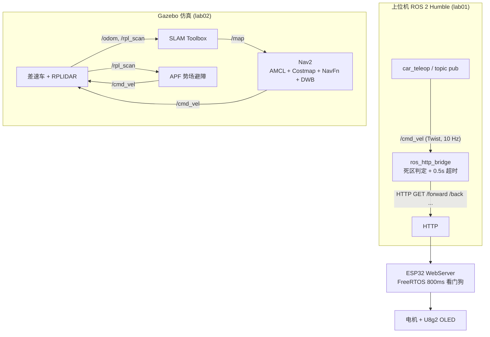

# Auto_Driving · 云衍小车 ROS 2 实验集

> ROS 2 Humble + ESP32 移动机器人学习实验集：从 `cmd_vel → HTTP` 实车控制，到 Gazebo 仿真、SLAM 建图、Nav2 与人工势场（APF）自主导航的完整链路。

[](https://docs.ros.org/en/humble/)
[](https://ubuntu.com/)
[](https://www.python.org/)
[](./LICENSE)

---

## 目录

- [项目简介](#项目简介)
- [核心特性](#核心特性)
- [系统架构](#系统架构)
- [项目结构](#项目结构)
- [实验一览](#实验一览)
- [环境要求与依赖安装](#环境要求与依赖安装)
- [快速开始](#快速开始)
- [示例命令](#示例命令)
- [关键参数](#关键参数)
- [常见问题（FAQ）](#常见问题faq)
- [安全须知](#安全须知)
- [许可证](#许可证)

---

## 项目简介

本仓库是一套面向学习与研发验证的 **ROS 2 + ESP32 移动机器人实验集合**，包含两个彼此独立、可直接构建的 colcon 工作空间：

- **`lab01_http_car`**：让一条 ROS 2 `cmd_vel` 消息最终驱动真实小车电机。ESP32 小车只提供离散 HTTP 接口（`/forward`、`/back`、`/left`、`/right`、`/stop`），本实验通过桥接节点把连续 `Twist` 消息「翻译」为 HTTP 请求，并配合双层超时机制保证失联停车。
- **`lab02_sim_slam_nav`**：在 Gazebo 中搭建差速小车与 RPLIDAR 仿真环境，完成 SLAM Toolbox 异步建图，并实现 **Nav2 工业级导航栈** 与 **自研 APF 人工势场避障** 双方案的对比验证。

> **说明**：本项目名称虽含 "Driving"，但它是**机器人移动控制 / 自主导航（navigation）**项目，**不是深度学习自动驾驶项目**——不依赖 GPU / CUDA，也没有神经网络模型。

每个实验自包含：ROS 2 上位机包、必要的固件 / 仿真资源、以及对应说明文档，均位于 `experiments/<实验名>/` 下。M1–M3 阶段已在仿真中完成闭环验证，下一步规划为实车硬件在环（HIL）迁移。

---

## 核心特性

### 实验一：`lab01_http_car`（实车控制链路）

- **`cmd_vel → HTTP` 桥接**：订阅标准 `/cmd_vel` 话题，经死区判定后以 10 Hz 向车端发送离散运动指令。
- **键盘遥操作**：`w/s/a/d/空格/q` 持续发布 `Twist`（固定频率，避免触发超时）。
- **双层超时停车**：上位机 0.5 s 未收到指令即改发 `/stop`；车端固件 800 ms 无运动请求由 FreeRTOS 看门狗强制停车。
- **ESP32 固件**：HTTP WebServer + 电机方向控制 + U8g2 OLED 状态显示 + 内置网页控制页。
- **可观测性**：`cmd_vel_observer` 调试节点、`ros2 topic hz/echo`、绕过 ROS 的 `curl` 直连验证。

### 实验二：`lab02_sim_slam_nav`（仿真建图与导航）

- **仿真环境**：8 m × 8 m 非对称封闭房间（L 型走廊 + 多组圆柱/方柱障碍）；参数化差速底盘 URDF/Xacro + 360° / 10 Hz RPLIDAR（含高斯测距噪声）。
- **SLAM 建图**：SLAM Toolbox 异步位姿图优化（扫描匹配 + Ceres 后端 + 回环检测），输出 0.05 m 高分辨率栅格地图。
- **方案 A · Nav2 工业级导航**：AMCL 粒子滤波自定位 + 双层代价地图膨胀 + NavFn 全局规划 + DWB 局部轨迹采样，支持已知静态地图导航与实时 SLAM 联调两种模式。
- **方案 B · APF 人工势场**：自研反应式避障节点，按距离平方反比生成斥力场，正前方死锁时原地自旋脱困；无需先验地图，CPU 占用极低。
- **双方案同场对比**：从先验要求、规划机制、资源占用、路径最优性、鲁棒性、适用场景等维度系统对比。
- **自动化工具**：一键编排与可视化脚本（Nav2 / APF 全流程录制、TF 树导出、地图标注等）。

### 工程约定

- 每个实验是**独立 colcon 工作空间**，互不干扰，切换实验无需清理旧 build。
- **凭据不入库**：Wi-Fi 密码等写入被 `.gitignore` 排除的本地文件，仓库只保留 `.example` 模板。
- 提交信息遵循 [Conventional Commits](https://www.conventionalcommits.org/)（`feat:` / `fix:` / `docs:` / `chore:` …），`main` 分支只保留可运行状态，改动走 `feature/<名字>` 分支。

---

## 系统架构



---

## 项目结构

```
Auto_Driving/
├── README.md                          ← 本文件
├── LICENSE                            ← Apache-2.0
├── .gitignore
└── experiments/
    ├── lab01_http_car/                ← 实验一：独立 colcon 工作空间
    │   ├── README.md                  ← 数据流、指令映射、故障排查、安全须知
    │   ├── src/
    │   │   ├── control_learn/         # cmd_vel 订阅观察节点
    │   │   └── yunyan_bringup/        # HTTP 桥接 + 键盘遥操作 + launch
    │   └── firmware/
    │       ├── README.md              # 接线表 / HTTP 接口 / 安全设计
    │       └── yunyan_car/
    │           ├── yunyan_car.ino     # ESP32 固件（Arduino）
    │           └── wifi_credentials.h.example  # 凭据模板（真实文件不入库）
    └── lab02_sim_slam_nav/            ← 实验二：独立 colcon 工作空间
        ├── README.md                  ← M1/M2/M3 运行手册
        ├── src/
        │   ├── yunyan_bringup/        # 键盘遥操作
        │   ├── yunyan_sim/            # Gazebo 仿真：URDF / world / RViz / launch
        │   └── yunyan_nav/            # SLAM 与导航：config / launch / maps / APF 节点
        └── scripts/                   # 可选：一键编排与可视化脚本
```

> `build/`、`install/`、`log/` 为 colcon 构建产物，按实验各自生成，不入库。

---

## 实验一览

| 实验 | 内容 | 关键产物 | 状态 |
|---|---|---|---|
| [`lab01_http_car`](experiments/lab01_http_car/) | `cmd_vel → HTTP` 桥接 → 云衍小车；键盘遥操作与 ESP32 固件 | 桥接节点、固件、双层看门狗 | ✅ 完成 |
| [`lab02_sim_slam_nav`](experiments/lab02_sim_slam_nav/) | Gazebo 差速车与雷达仿真、SLAM 建图、Nav2 / APF 自主导航 | 仿真世界、栅格地图、双导航方案 | ✅ M1 / M2 / M3 完成 |

---

## 环境要求与依赖安装

| 类别 | 版本 / 说明 |
|---|---|
| 操作系统 | Ubuntu 22.04 LTS |
| ROS | ROS 2 Humble Desktop |
| Python | 3.10 |
| 构建工具 | `python3-colcon-common-extensions` |
| 仿真 / 导航 | Gazebo 11、`slam_toolbox`、`navigation2`、`nav2_bringup`、`tf2_tools` |
| 图形界面 | X11 桌面环境（Gazebo / RViz2 必需，不支持纯 headless） |
| 固件开发（仅实验一） | Arduino IDE + ESP32 board package + [U8g2](https://github.com/olikraus/u8g2) |
| Python 库（仅可选报告脚本） | `PyYAML`、`numpy`、`Pillow`、`matplotlib`、`opencv-python` |
| 系统工具（仅可选报告脚本） | `ffmpeg`、`poppler-utils`、`x11-utils`、中文字体 |

> **无 GPU / CUDA 要求**：所有算法在 CPU 上运行；SLAM 的 Ceres 求解器为 C++ 后端，无需深度学习框架。

### 1. 安装 ROS 2 与依赖

```bash
sudo apt update
sudo apt install ros-humble-desktop \
                 ros-humble-slam-toolbox \
                 ros-humble-navigation2 \
                 ros-humble-nav2-bringup \
                 ros-humble-gazebo-ros-pkgs \
                 ros-humble-tf2-tools \
                 python3-colcon-common-extensions
```

### 2. 安装可选依赖（仅运行 `scripts/` 下的编排 / 可视化脚本时需要）

```bash
sudo apt install ffmpeg poppler-utils x11-utils fonts-noto-cjk
python3 -m pip install pyyaml numpy pillow matplotlib opencv-python
```

### 3. 获取代码

```bash
git clone https://github.com/lifelinezzz90/Auto_Driving.git
cd Auto_Driving
export REPO_ROOT=$PWD
```

---

## 快速开始

> 每个实验都是**独立工作空间**，请先进入对应实验目录再构建。以下命令中的 `$REPO_ROOT` 为仓库根目录；若你克隆到了别的目录名，请以实际路径为准（子实验 README 中的 `~/Auto_Driving` 同理，可克隆为该目录名或自行替换）。

### 通用构建（每个实验只需一次）

```bash
cd $REPO_ROOT/experiments/lab01_http_car     # 或 lab02_sim_slam_nav
source /opt/ros/humble/setup.bash
colcon build --symlink-install
source install/setup.bash
```

`--symlink-install` 使修改 Python 代码后无需重新 build、重启节点即可生效（新增节点或修改 `setup.py` 的 `entry_points` 时仍需重新 build）。**每个新终端都要重新 `source install/setup.bash`**。

---

### 实验一：用 ROS 2 控制真实小车

**前置条件**

1. 小车上电并连接到与电脑相同的 Wi-Fi，OLED 上可见 IPv4 地址（例如 `192.168.31.11`）。
2. 首次烧录固件前，创建本地凭据文件（真实文件已被 `.gitignore` 排除，永不入库）：

   ```bash
   cd $REPO_ROOT/experiments/lab01_http_car/firmware/yunyan_car
   cp wifi_credentials.h.example wifi_credentials.h
   # 编辑 wifi_credentials.h，填入你的 SSID 与密码，再用 Arduino IDE 烧录
   ```

3. 在电脑上确认小车可达：

   ```bash
   curl --noproxy '*' --max-time 2 http://192.168.31.11/stop     # 期望返回 OK
   ```

   > `--noproxy '*'` 不能省：若 shell 配置了 `http_proxy`，而桥接节点内部禁用了代理，两边不一致会导致误判「车不通」。

**运行（多终端）**

```bash
# 终端 1：启动桥接（IP 换成你小车 OLED 上显示的地址）
ros2 launch yunyan_bringup car.launch.py car_ip:=192.168.31.11

# 终端 2：键盘遥操作（w/s/a/d/空格/q）
ros2 run yunyan_bringup car_teleop
```

按下 `w` 后，终端 1 打印 `指令切换：forward` 即表示链路打通。完整指令映射、调试手段与故障排查见 [`lab01 README`](experiments/lab01_http_car/README.md)。

---

### 实验二：Gazebo 仿真、建图与自主导航

```bash
cd $REPO_ROOT/experiments/lab02_sim_slam_nav
source /opt/ros/humble/setup.bash
colcon build --symlink-install
source install/setup.bash
```

**M1 · 基础仿真**

```bash
# 终端 1：启动 Gazebo + 机器人 + RViz2
ros2 launch yunyan_sim sim_bringup.launch.py
# 终端 2：键盘遥操作
ros2 run yunyan_bringup car_teleop
```

**M2 · SLAM 在线建图与存图**

```bash
# 终端 1
ros2 launch yunyan_sim sim_bringup.launch.py
# 终端 2：启动异步建图
ros2 launch yunyan_nav slam_sim.launch.py
# 终端 3：遥控巡游建图
ros2 run yunyan_bringup car_teleop
# 终端 4：保存地图
ros2 run nav2_map_server map_saver_cli -f src/yunyan_nav/maps/slam_room_map
```

**M3 · 自主导航（双方案）**

```bash
# 方案 B：APF 无地图避障（小车自动 0.18 m/s 前行避障）
ros2 launch yunyan_sim sim_bringup.launch.py
ros2 run yunyan_nav apf_avoidance

# 方案 A 模式 1：Nav2 加载已保存静态地图
ros2 launch yunyan_nav nav2_sim.launch.py
# 在 RViz 顶部点击 2D Goal Pose，给定目标点与航向角即可自主导航

# 方案 A 模式 2：实时 SLAM + Nav2 联调
ros2 launch yunyan_nav nav2_sim.launch.py slam:=True
```

> APF 节点已设好初速度，启动后自动避障；Nav2 默认出生位姿已对齐原点 `(0, 0, 0)`。更多细节见 [`lab02 README`](experiments/lab02_sim_slam_nav/README.md)。

### 可选：一键编排脚本

```bash
cd $REPO_ROOT/experiments/lab02_sim_slam_nav
source /opt/ros/humble/setup.bash && source install/setup.bash
python3 scripts/run_navigation_pipeline.py    # Nav2 全流程 + 录制
python3 scripts/run_apf_pipeline.py           # APF 避障 + 录制
python3 scripts/export_tf_tree.py             # 导出 TF 树图
python3 scripts/generate_hd_map.py            # 生成高精地图标注图
```

> 这些脚本需要 X11 桌面与上文「可选依赖」，生成的图片 / 地图标注等产物写入本地 `report_assets/` 目录，**不属于仓库公开内容，也不入库**。脚本路径基于自身位置解析，克隆到任意目录均可运行。

---

## 示例命令

```bash
# —— 实验一 ——
# 校验车端连通（绕过代理）
curl --noproxy '*' --max-time 2 http://192.168.31.11/stop
# 命令行直接发布速度（保持 -r 10）
ros2 topic pub -r 10 /cmd_vel geometry_msgs/msg/Twist '{linear: {x: 0.3}}'     # 前进
ros2 topic pub -r 10 /cmd_vel geometry_msgs/msg/Twist '{angular: {z: 0.5}}'    # 左转
# 调试：话题频率 / 内容 / 订阅观察节点
ros2 topic hz /cmd_vel
ros2 topic echo /cmd_vel
ros2 run control_learn cmd_vel_observer
# 绕过 ROS 直接验证车端动作
curl --noproxy '*' http://192.168.31.11/forward

# —— 实验二 ——
ros2 launch yunyan_sim sim_bringup.launch.py
ros2 launch yunyan_nav slam_sim.launch.py
ros2 run yunyan_nav apf_avoidance
ros2 launch yunyan_nav nav2_sim.launch.py slam:=True
ros2 run nav2_map_server map_saver_cli -f src/yunyan_nav/maps/slam_room_map
```

---

## 关键参数

| 参数 | 位置 | 默认值 | 含义 |
|---|---|---|---|
| `http_server_ip` | `car.launch.py` 的 `car_ip:=` | `192.168.31.11` | 车端 IP |
| `command_timeout` | `ros_http_bridge` | 0.5 s | 超时未收到 `cmd_vel` 即改发 `/stop` |
| `send_period` | `ros_http_bridge` | 0.1 s | HTTP 发送周期（10 Hz） |
| `http_timout` | `ros_http_bridge` | 0.25 s | 单次 HTTP 请求超时 |
| `deadzone` | `ros_http_bridge` | 0.1 | 判「动 / 不动」的死区 |
| `COMMAND_TIMEOUT_MS` | 固件 | 800 ms | 车端兜底停车时间 |
| `speed` / `turn` | `car_teleop` | 0.3 / 0.5 | 发布的 `linear.x` / `angular.z` 幅值 |
| `resolution` | SLAM 建图 | 0.05 m/cell | 栅格地图分辨率（5 cm/像素） |
| `max_laser_range` | SLAM 建图 | 12.0 m | 建图有效测距，覆盖 8 m × 8 m 全场 |
| `forward_speed` | `apf_avoidance` | 0.18 m/s | APF 巡航线速度 |
| `repulsion_max_dist` | `apf_avoidance` | 0.80 m | 斥力影响半径 |
| `deadlock_dist` | `apf_avoidance` | 0.35 m | 正前方死锁脱困触发距离 |
| 地图尺寸 | `slam_room.world` | 8 m × 8 m | 封闭测试房间 |

---

## 常见问题（FAQ）

**Q1：`ros2 topic pub` 为什么要加 `-r 10`？**
桥接节点有 0.5 s 超时。发布频率低于 2 Hz 时，大部分时间落在超时之外，表现为「走一下停一下」（实测 10 Hz 约 92% 周期在发 `forward`，1 Hz 仅剩 38%）。务必用 `-r 10` 或 `car_teleop`。

**Q2：`ros2 node list` 有节点，但车一动不动、日志也不报错？**
按链路逐段排查：① 桥接终端是否打印 `指令切换：forward`；② `ros2 topic hz /cmd_vel` 看发布频率；③ 用 `curl --noproxy '*' http://<IP>/forward` 绕过 ROS 直连验证；④ 检查 Wi-Fi、供电、电机驱动，以及是否有网页控制端同时占用（ESP32 WebServer 单客户端）。桥接的 HTTP 发送线程已做异常捕获与保活，不会静默退出。

**Q3：报错 `Package 'yunyan_bringup' not found`？**
当前终端没有加载工作空间环境。进入对应实验目录后执行 `source install/setup.bash`（可写入 `~/.bashrc` 持久化）。

**Q4：`curl` 失败，但浏览器能打开车机网页？**
shell 大概率配了 `http_proxy`。加 `--noproxy '*'` 即可；桥接节点内部也用 `ProxyHandler({})` 禁用了代理，保持两边一致。

**Q5：把 `linear.x` 从 0.3 改成 0.9，车速没变化？**
这是设计限制。车端固件 `applyMotionLocked()` 用 `digitalWrite(HIGH)` 满占空比导通，没有 PWM，桥接只取 `linear.x` 的**符号**。真正的调速需要改固件用 `ledcWrite`，或在桥接层做占空比调度（会有顿挫且频繁启停伤电机）。

**Q6：明明想转弯，发出的却是 `stop`？**
当 `linear` 与 `angular` 同时超过死区 0.1 时，桥接判定为 `stop`——本小车只有 5 条离散指令，**不支持边走边转**。请分开给：要么纯直行，要么纯转向。

**Q7：固件烧录失败或偶尔启动不了？**
GPIO 12 是 ESP32 的 strapping 引脚（决定启动时 flash 电压），接电机驱动后上电瞬间电平会影响启动，优先怀疑此处。

**Q8：Gazebo / RViz2 打不开或黑屏？**
需要 X11 图形桌面与正确的 `DISPLAY`；确认已安装 `ros-humble-gazebo-ros-pkgs` 与 `rviz2`。纯服务器 headless 环境不支持。

**Q9：TF 树里缺 `map → odom`？**
该变换由建图 / 定位节点广播：M2 需启动 SLAM Toolbox，M3 需启动 Nav2（AMCL）。可用 `scripts/export_tf_tree.py` 导出完整 TF 拓扑图核对。

**Q10：Wi-Fi 密码会泄露吗？**
不会。真实 `wifi_credentials.h` 被 `.gitignore` 排除，仓库仅有 `.example` 模板（只含占位符）。提交前请再次确认未加入真实凭据。

**Q11：子实验 README 里的 `~/Auto_Driving` 路径怎么办？**
可将仓库克隆为 `~/Auto_Driving`，或把所有 `~/Auto_Driving` 替换为你的实际仓库根目录（本 README 统一用 `$REPO_ROOT` 表示）。

**Q12：APF 与 Nav2 该选哪个？**
需要**全局最优路径、已知地图、复杂迷宫**用 Nav2；**无需先验地图、算力受限、紧急防撞保底**用 APF。两者的详细维度对比见实验二文档与阶段报告。

---

## 安全须知

- **软件保护不能替代硬件保护**：必须保留人工断电与硬件急停。MCU 整体卡死、供电或驱动故障无法靠软件兜住。
- **首次测试请架空车轮**，确认方向映射（尤其左右转向）正确后再落地。
- 车速由固件固定且偏快，第一次运行留足场地余量，手放在电源开关旁。
- 退出时按 `q` 或 `Ctrl-C`，程序会显式补发一帧全零，车在 0.5 s 内停住。

---

## 许可证

本项目采用 [Apache License 2.0](./LICENSE)。
