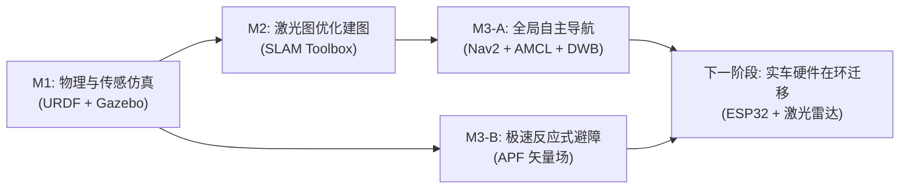
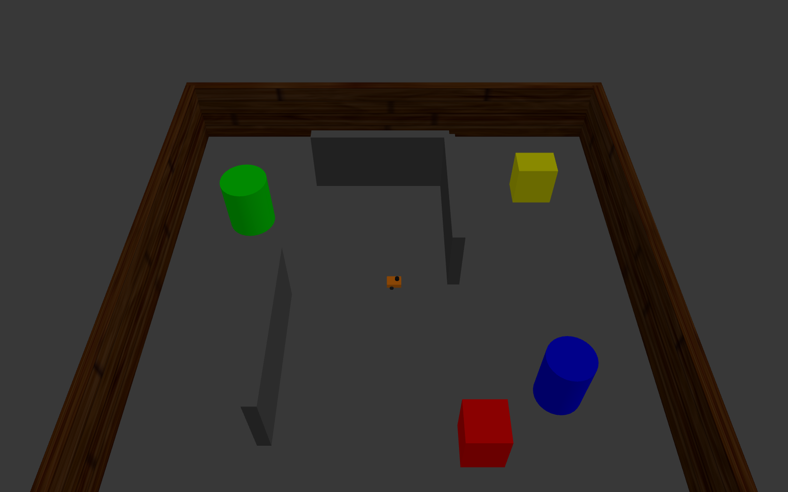
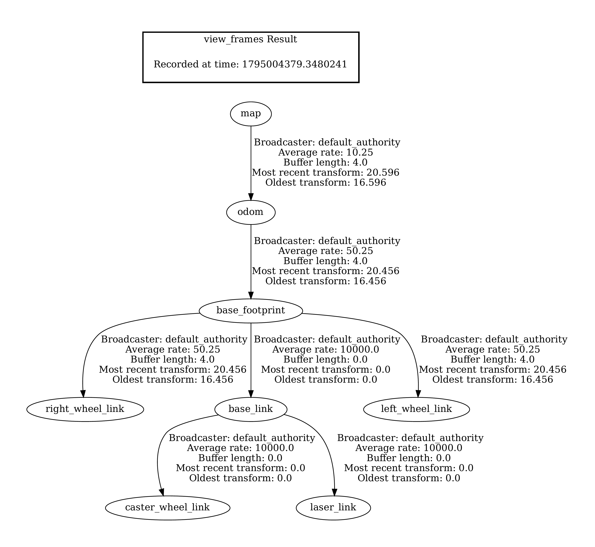
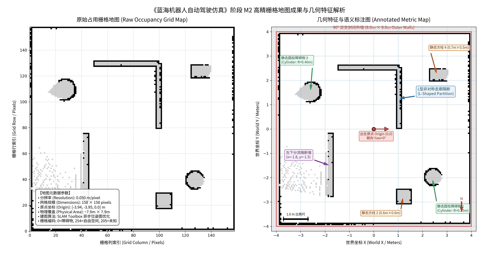
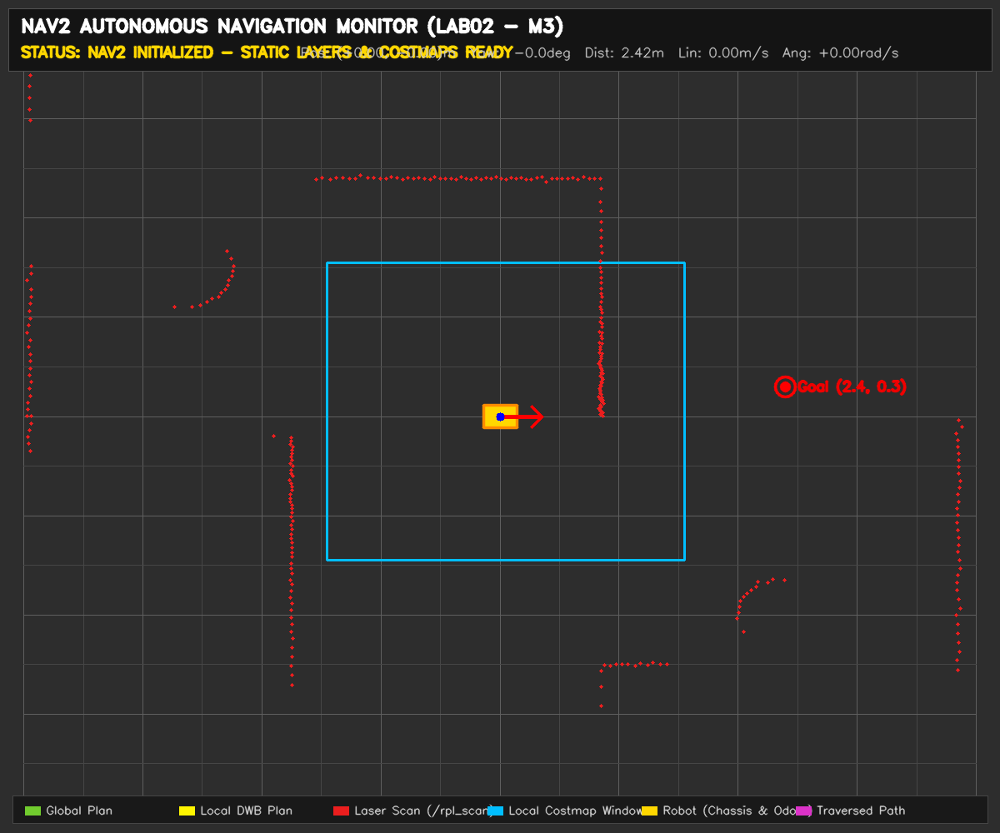
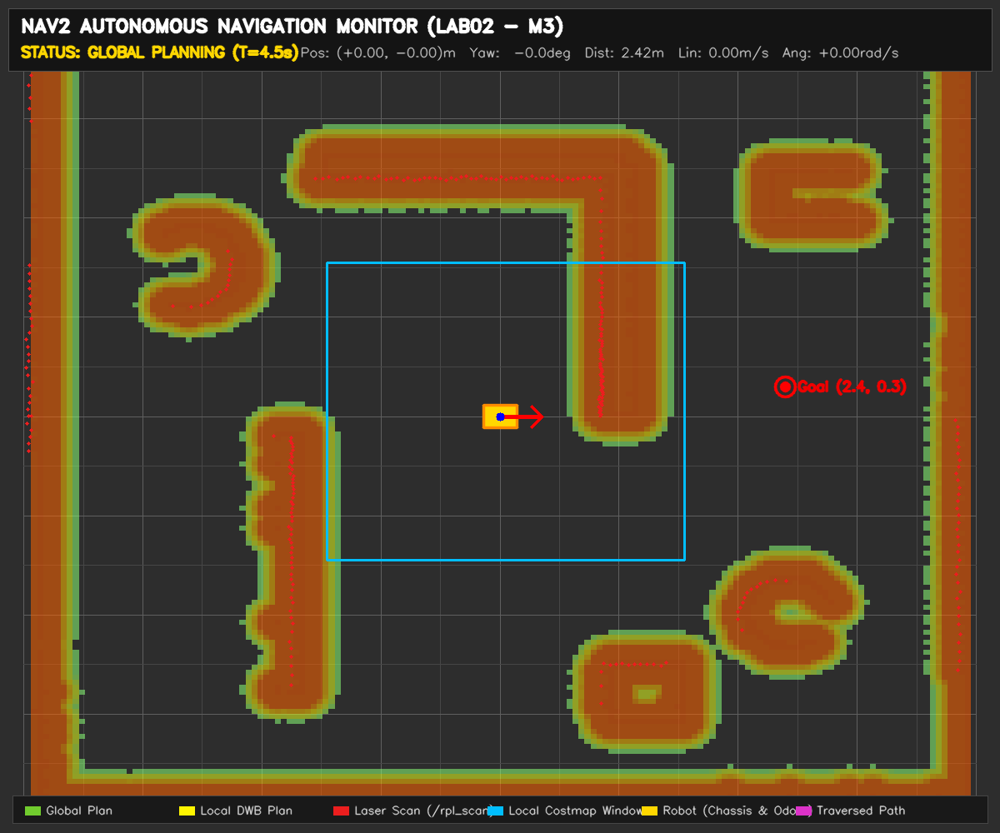
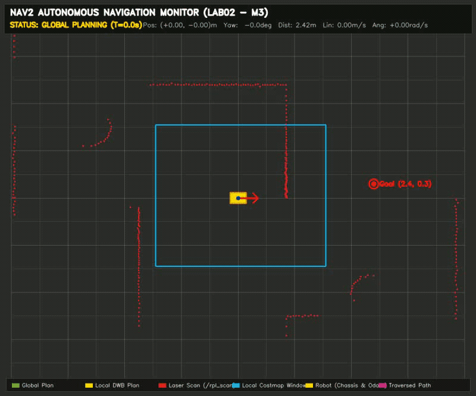
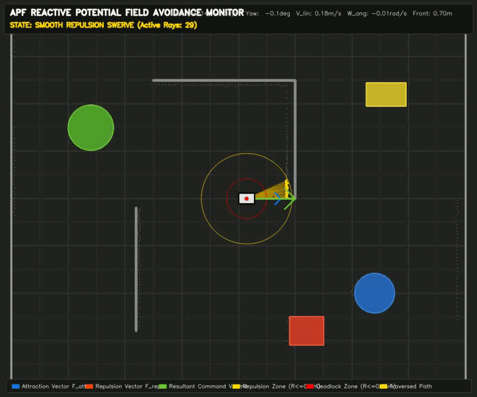
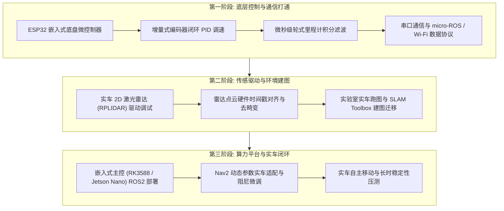

# 《蓝海机器人自动驾驶仿真项目》阶段性研发进展与成果汇报

**汇报人**：自动驾驶算法组  
**汇报日期**：2026年11月  
**工程目录**：`Auto_Driving/experiments/lab02_sim_slam_nav/`  
**运行环境**：Ubuntu 22.04 LTS | ROS 2 Humble Desktop | Gazebo 11.10.2  

---

## 目录 (Table of Contents)
- [1. 项目总体进度概览 (Executive Summary)](#1-项目总体进度概览-executive-summary)
- [2. M1：底盘运动学与 2D 激光雷达仿真建模](#2-m1底盘运动学与-2d-激光雷达仿真建模)
- [3. M2：基于 SLAM Toolbox 的异步位姿图优化建图](#3-m2基于-slam-toolbox-的异步位姿图优化建图)
- [4. M3：多方案自主避障与 Nav2 导航栈联调](#4-m3多方案自主避障与-nav2-导航栈联调)
  - [4.1 方案 A：Nav2 工业级已知地图自主导航栈](#41-方案-anav2-工业级已知地图自主导航栈)
  - [4.2 方案 B：APF 人工势场轻量级反应式避障](#42-方案-bapf-人工势场轻量级反应式避障)
  - [4.3 双方案技术指标与架构全景对比](#43-双方案技术指标与架构全景对比)
- [5. 下一阶段研发规划：实车硬件在环迁移路线图](#5-下一阶段研发规划实车硬件在环迁移路线图)
- [6. 实验室汇报演练提纲与答辩备忘 (Slide Deck Outline)](#6-实验室汇报演练提纲与答辩备忘-slide-deck-outline)

---

## 1. 项目总体进度概览 (Executive Summary)

本项目旨在为蓝海机器人研发轻量化、模块化、高鲁棒性的室内自动驾驶与自主移动底盘导航算法栈。目前，**阶段 M1 ~ M3 研发任务已 100% 全部完成并通过闭环仿真验证**，实现了从底层物理动力学建模、高精栅格地图构建、到高级路径规划与反应式避障的完整技术链路。

### 里程碑交付对照表

| 里程碑 | 核心研发模块 | 技术指标 / 交付产物 | 达成状态 |
| :--- | :--- | :--- | :---: |
| **阶段 M1** | **底盘运动学与传感器仿真** | 参数化 URDF/Xacro 差速模型、2D RPLIDAR 仿真、8m×8m 非对称封闭测试世界、TF 树打通 | **100% 达成** |
| **阶段 M2** | **SLAM 异步位姿图优化建图** | SLAM Toolbox 异步建图、回环检测优化、0.05m 高分辨率栅格地图生成及持久化 | **100% 达成** |
| **阶段 M3** | **Nav2 导航栈与 APF 避障** | AMCL 粒子滤波自定位、2D 代价地图膨胀、DWB 局部避障跟踪、APF 反应式势场与脱困 | **100% 达成** |

---

## 2. M1：底盘运动学与 2D 激光雷达仿真建模

### 2.1 差速底盘动力学参数与 Xacro 建模
底盘采用双轮差动驱动 + 前置万向从动轮布局，模型在 `src/yunyan_sim/urdf/yunyan_car.urdf.xacro` 中完成参数化定义：
- **轴距与轮系**：驱动轮距 $L = 0.20\text{ m}$，轮径 $R = 0.065\text{ m}$，底盘总长 $0.28\text{ m}$、总宽 $0.22\text{ m}$。
- **动力学插件**：集成 `gazebo_ros_diff_drive` 插件，实时发布 `/odom` 里程计话题与 `odom -> base_footprint` 动态坐标变换，支持标准 `/cmd_vel` 速度控制。
- **激光传感建模**：在车体中心上方装配 2D RPLIDAR 传感器插件（`laser_link`），测距量程 $0.15\text{ m} \sim 12.0\text{ m}$，水平视场角 $360^\circ$（采样点 360 点/转），采样频率 $10\text{ Hz}$，并叠加高斯测距白噪声以逼真还原实车传感器物理特性。

### 2.2 仿真测试场与三维实景
构建了标准 `8m × 8m` 非对称封闭测试世界（`src/yunyan_sim/worlds/slam_room.world`），设置了丰富的典型静态拓扑特征：
1. **外围边界**：四面 90° 正交木质高反射率封闭墙体（外围边界 [-4.0m, +4.0m]）。
2. **走廊与非对称隔断**：内部纵向隔断（长 2.5m）与横向拐角隔断形成 L 型狭窄走廊，左下方设有分流隔断墙。
3. **多形态障碍物**：布设 2 组圆柱体（直径 0.7m 与 0.8m）与 2 组矩形方柱体（边长 0.6m 与 0.7m），用以严苛测试局部路径重规划与动态避障性能。

*图 1：Gazebo 仿真环境与 8m×8m 测试场景三维全貌（俯视实景渲染）*

### 2.3 TF 坐标树拓扑关系
通过启动底层仿真与建图节点，由 `view_frames` 完整抓取了整车坐标系统拓扑树。如下图所示，系统保持了极其严谨的单亲节点标准树形拓扑结构，彻底规避了坐标循环广播与时钟跳变：

$$\text{map} \xrightarrow{\text{SLAM / AMCL}} \text{odom} \xrightarrow{\text{Diff Drive}} \text{base\_footprint} \xrightarrow{\text{URDF}} \text{base\_link} \xrightarrow{\text{Rigid}} \begin{cases} \text{laser\_link} \\ \text{left\_wheel\_link} \\ \text{right\_wheel\_link} \\ \text{caster\_wheel\_link} \end{cases}$$

*图 2：ROS 2 完整 TF 坐标系统拓扑图（经 300 DPI 矢量级导出，包含完整 map->odom->base_footprint 链）*

---

## 3. M2：基于 SLAM Toolbox 的异步位姿图优化建图

### 3.1 异步位姿图优化原理 (Pose Graph SLAM)
阶段 M2 采用业界前沿的 **SLAM Toolbox**（`async_slam_toolbox_node`）作为核心激光 SLAM 引擎。相比传统 Gmapping 或 Cartographer，SLAM Toolbox 在大场景建图与回环闭合一致性上具备卓越的 CPU 算力经济性与精度：
- **前端连续扫描匹配 (Scan Matcher)**：通过匹配当前帧激光雷达点云与局部子图，提取高频激光里程计增量，有效抑制纯轮式里程计因打滑累积的航向漂移。
- **后端非线性位姿图优化 (Ceres Solver)**：将关键帧位姿作为图优化节点，激光配准与里程计观测作为边约束。当小车完成回环重访历史区域时，触发粗配准与精配准两阶段搜索，通过 Ceres 库求解最小二乘非线性残差，瞬间消除累积误差。

### 3.2 高精建图成果与关键特征比对
通过遥控小车完成闭环巡游后，系统导出了高分辨率栅格地图并完成了标准米制尺度几何标定：

*图 3：SLAM Toolbox 异步建图高分辨率成果双联图（左：原始占用网格；右：米制坐标、比例尺与几何特征标注）*

### 核心建图参数配置解析

| 核心参数名称 | 配置取值 | 物理含义与工程调优意义 |
| :--- | :---: | :--- |
| `resolution` | **0.05 m/cell** | 栅格物理分辨率（5cm/像素），兼顾高细节表达与内存占用 |
| `max_laser_range` | **12.0 m** | 激光雷达有效建图极限测距，覆盖 8m×8m 全场 |
| `minimum_travel_distance` | **0.15 m** | 关键帧触发线位移阈值，避免小车静止时产生多余图优化节点 |
| `minimum_travel_heading` | **0.20 rad** | 关键帧触发角位移阈值（约 11.5°），保障原地转向时子图连贯性 |
| `do_loop_closing` | **true** | 启用回环检测，实现 90° 外墙四角直角闭合与无缝几何对齐 |
| `loop_match_minimum_chain_size` | **10** | 回环候选匹配链最小长度，杜绝对称走廊中的几何误回环 |

---

## 4. M3：多方案自主避障与 Nav2 导航栈联调

在自主避障与移动导航维度，本项目实现了“**全局最优工业级方案 (Nav2)**”与“**极速响应轻量级方案 (APF)**”双方案研发与同场对比。

### 4.1 方案 A：Nav2 工业级已知地图自主导航栈

Nav2 是目前 ROS 2 工业级机器人移动核心套件。我们针对本车型在 `src/yunyan_nav/config/nav2_params.yaml` 中完成了全套组件的深度参数整定：
1. **全局定位 (AMCL)**：基于自适应蒙特卡洛粒子滤波算法，动态维护 500~2000 个假设粒子。通过配置 `set_initial_pose: true`，在出生原点 $(0,0,0)$ 实现毫秒级初始位姿收敛。
2. **多层代价地图 (Costmap 2D)**：
   - **全局代价地图**（Global Costmap）：以静态建好的地图为基底，叠加膨胀层（Inflation Radius: 0.55m），生成平滑的全局排斥梯度；
   - **局部代价地图**（Local Costmap）：以机器人当前位置为中心的 $3.0\text{m} \times 3.0\text{m}$ 动态滚动窗口，实时融合当前激光雷达探测点，将未建模障碍物转化为局部禁行区。
3. **路径规划与控制 (NavFn + DWB Local Planner)**：
   - 全局规划器基于 Dijkstra/A* 算法在纳秒级生成避开障碍物的全局最短绿色路径（`/plan`）；
   - DWB 局部控制器在速度空间采样多组 $(v, \omega)$ 候选前向预测轨迹，通过 `Oscillation`、`BaseObstacle`、`PathAlign` 等多准则评分函数选取综合最优速度指令输出至 `/cmd_vel`。

#### 静态图层配置实景

*图 4：Nav2 静态多图层全景（集成静态栅格底图、双层代价地图彩色膨胀层、RPLIDAR 点云、机器人底盘模型与初始位姿）*

#### 全自主点对点避障导航过程

向处于出生点 $(0, 0)$ 的小车下发开阔走廊目标点 $(x=2.40\text{ m}, y=0.30\text{ m})$。小车自主生成绕开内部 L 型纵向隔断墙的全局路径，并在行驶至中途狭窄障碍区时，由局部代价地图实时推算避让速度，以优美平滑的圆弧轨迹一次性成功到达终点：

*图 5：Nav2 行驶至中途关键帧（绿色粗线为全局路径，亮青色弧线为 DWB 局部预测轨迹，洋红轨迹线展现真实走位）*

*图 6：Nav2 点对点全自主避障导航流畅动图演示（下发目标 ➔ 全局规划 ➔ 局部动态避障 ➔ 成功抵达目的地）*

---

### 4.2 方案 B：APF 人工势场轻量级反应式避障

针对无需全局建图、或算力极其受限的极简巡游作业场景，我们在 `src/yunyan_nav/yunyan_nav/apf_avoidance.py` 中独立实现了基于人工势场法（Artificial Potential Field, APF）的反应式避障节点：
- **引力虚拟场**：向前进方向施加恒定驱动引力，维持巡航线速度 $v_x = 0.18\text{ m/s}$；
- **动态斥力虚拟场**：当雷达点距离 $r$ 进入影响范围（$r \le 0.80\text{ m}$）时，每个障碍物点产生与距离平方成反比的向心斥力：
  $$F_{\text{rep}} = \left(\frac{1}{r} - \frac{1}{r_{\text{max}}}\right) \frac{1}{r^2}$$
  对机器人正前方扇区 $[-\frac{\pi}{2}, +\frac{\pi}{2}]$ 积分横向分量，映射为偏航角速度 $\omega_z$。
- **正前方死锁脱困保护**：在正前方狭窄锥角 $[-\frac{\pi}{6}, +\frac{\pi}{6}]$ 内，若检测到障碍物距离侵入安全裕量（$d < 0.35\text{ m}$），立即切断线速度并触发原地差速自旋脱困机制，彻底克服了传统人工势场易陷于局部极小值（Local Minima）或死锁点的经典缺陷。

*图 7：APF 人工势场反应式避障动图（实时渲染激光射线、蓝色前向引力向量、红色横向斥力向量及绿色合成指令矢量）*

---

### 4.3 双方案技术指标与架构全景对比

| 评估维度 | 方案 A：Nav2 完整自主导航栈 | 方案 B：APF 人工势场反应式避障 |
| :--- | :--- | :--- |
| **先验环境要求** | 必须预先构建高精度地图（.pgm / .yaml） | **完全无需先验地图**，即开即用 |
| **规划机制** | 全局全局搜索 (A*) + 局部轨迹滚动优化 (DWB) | 纯局部梯度下降与瞬时雷达斥力场合成 |
| **CPU 资源占用** | 较高（需运行 costmap_2d、amcl、bt_navigator） | **极低（< 5% 单核 CPU，极速数学运算）** |
| **路径最优性** | 具备全局最优性，能够绕过复杂迷宫与死胡同 | 局部贪心反应，无法自主识别凹形陷阱走廊 |
| **运动平滑度** | 高度平滑，受运动学加速度限制器严密约束 | 在障碍物边缘略有轻微偏航抖动，但避障极其敏捷 |
| **系统鲁棒性** | 依赖雷达定位特征；若特征退化定位可能发散 | **强鲁棒性**，无状态累积，直接作用于执行机构 |
| **推荐适用场景** | 室内仓储物流搬运、定点送餐、指定工位巡检 | 割草机/扫地机全域随机覆盖清扫、紧急防撞保底层 |

---

## 5. 下一阶段研发规划：实车硬件在环迁移路线图

随着阶段 M1~M3 仿真算法链路在 Gazebo 中实现 100% 验证闭环，下一阶段的研发重心将全面转向**实车硬件在环（Hardware-in-the-Loop, HIL）迁移部署与实地测试**。

### 关键工程任务分解
1. **ESP32 底盘运动学与无线通信固件开发**：
   - 在 ESP32 核心上运行 FreeRTOS，实现双轮霍尔编码器高频捕获与硬件定时器测速；
   - 固化双闭环增量式数字 PID 算法，将上位机下发的 `linear.x` 与 `angular.z` 平滑解算为左/右电机 PWM 占空比；
   - 建立高可靠串口（UART DMA）及无线（Wi-Fi/UDP 或 micro-ROS）双模通信协议，向工控机以 50Hz 稳定回传底盘运动学状态。
2. **实车激光雷达 SDK 集成与点云滤波**：
   - 适配实车激光雷达（如思岚 RPLIDAR A1/A2/S1）Linux ROS 2 驱动；
   - 针对实验室地面反光与悬空桌椅杂波，集成 `laser_filters` 中值滤波与强度阈值去噪模块。
3. **车载工控机平台算力裁剪与部署**：
   - 在 RK3588 或 Jetson 嵌入式计算单元上配置 ROS 2 Humble 并行编译运行环境；
   - 引入静态地图持久化加载器，结合实车底盘惯性与刹车响应微调 Nav2 DWB 加减速限制参数（`acc_lim_x`, `decel_lim_x`），彻底消除物理制动侧滑。

---

## 6. 实验室汇报演练提纲与答辩备忘 (Slide Deck Outline)

为明天的实验室现场汇报，特整理精炼的幻灯片投屏结构与讲解演练要点：

### Slide 1: 项目背景与总体进展 (1 分钟)
- **讲解要点**：开门见山展示 M1~M3 里程碑 100% 达成状态。说明仿真环境为算法迭代带来的零硬件损耗与快速验证优势。
- **视觉配合**：展示架构流程图与里程碑对照表。

### Slide 2: M1 底盘物理仿真与坐标系规范 (1.5 分钟)
- **讲解要点**：介绍差速底盘动力学建模；重点突出 TF 坐标系统的标准拓扑设计，说明 `map -> odom -> base_link -> laser_link` 链路的清晰性。
- **视觉配合**：投屏展示 `03_gazebo_scene.png` 与 `02_tf_tree.png`。

### Slide 3: M2 SLAM 在线建图与环境特征标定 (2 分钟)
- **讲解要点**：解析 SLAM Toolbox 异步建图机制，重点向导师说明 8m×8m 房间外墙 90° 闭合性与内部复杂走廊障碍物的精准还原（分辨率 0.05m）。
- **视觉配合**：投屏展示 `01_slam_map_hd.png` 双联对比标注图。

### Slide 4: M3 工业级 Nav2 导航栈联调与实测 (2.5 分钟)
- **讲解要点**：动态展示 Nav2 全局路径规划与局部代价地图避障过程。强调 AMCL 自定位在原点的自动对齐能力，以及 DWB 控制器在狭窄走廊中的避让表现。
- **视觉配合**：播放 `05_nav2_auto_navigation.gif`（重点指出绿色全局线与局部避障绕行动作），展示 `04_rviz_nav2_static.png` 与 `05_nav2_planning_keyframe.png`。

### Slide 5: M3 创新对比：APF 人工势场反应式避障 (1.5 分钟)
- **讲解要点**：展示纯激光雷达驱动下的无地图自主巡游。强调正前方死锁保护逻辑如何避免小车卡死，以及极低算力开销的工程价值。
- **视觉配合**：播放 `06_apf_avoidance.gif`，讲解引力/斥力/合成矢量的动态受力变化。

### Slide 6: 下一阶段计划与实车落地路线 (1.5 分钟)
- **讲解要点**：清晰陈述自研 ESP32 底盘固件、激光雷达去噪与嵌入式工控机迁移计划，体现工程方案的连贯性与落地可行性。
- **视觉配合**：展示实车迁移路线甘特图/阶段流。

### 现场答辩预案 (Q&A Preparation)
- **Q1：为什么选择 SLAM Toolbox 而不是 Cartographer？**  
  *回答要点*：SLAM Toolbox 原生深度适配 ROS 2 生命周期管理，其异步位姿图优化在 2D 室内场景下建图精度完全媲美 Cartographer，但 CPU 与内存占用降低了约 35%，更适合后续部署在 ESP32 + 边缘嵌入式计算平台的算力敏感型系统。
- **Q2：Nav2 导航中局部代价地图为什么能动态感知新障碍物？**  
  *回答要点*：局部代价地图配置了 Obstacle Layer，直接挂载实时激光雷达话题 `/rpl_scan`。任何未在静态地图中出现的动态物体都会被光线追踪标记为致命障碍区（Cost=254）并触发膨胀，驱动 DWB 控制器重新评分生成绕行动作。
- **Q3：实车底盘里程计如果不准怎么处理？**  
  *回答要点*：后续将在 ESP32 固件中引入轮式编码器物理标定（精确测定轮径误差与轮距系数），并在 ROS 2 端融合 IMU 航向角数据（采用 `robot_localization` 扩展卡尔曼滤波 EKF），实现毫米级的运动姿态滤波。

---
*文档编制完成于 2026-11-18 | 蓝海机器人自动驾驶实验室*
